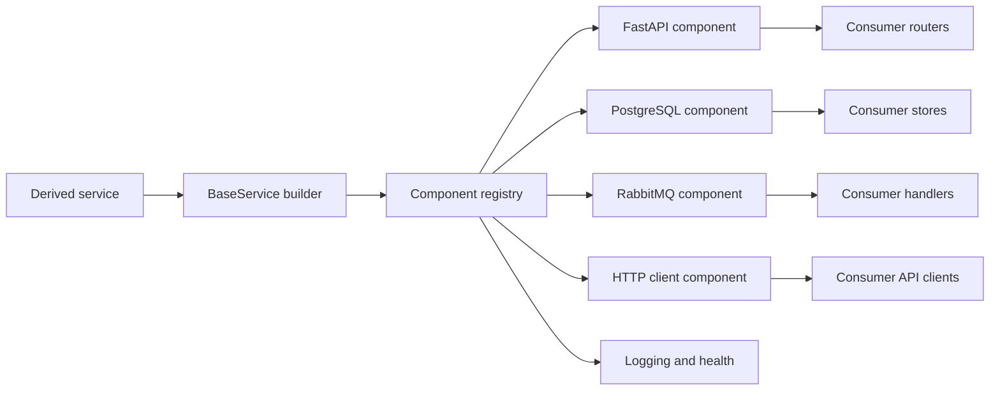

# Base Service Plan

## Overview and Intent

`base-service` is an asynchronous Python foundation for microservices built by
the project owner. It removes repeated infrastructure setup so a derived service
can focus on:

- FastAPI routers and application behavior
- domain-specific repositories and stores
- business rules and workflows

The repository is also a portfolio project. Its design, documentation, tests,
and release process must demonstrate production-oriented engineering rather
than only a working prototype.

## Users

The primary user is the maintainer of derived microservices. The secondary
audience is reviewers and potential employers evaluating the architecture and
implementation quality.

The base service should provide common infrastructure with clear extension
points. Derived services should not need to reimplement component startup,
shutdown, configuration loading, clients, or observability plumbing.

## Scope

### Initial capabilities

- An asynchronous component registry and service lifecycle
- A FastAPI and ASGI server component
- Pydantic-based settings and validation
- PostgreSQL connectivity
- RabbitMQ connectivity
- Outbound HTTP with HTTPX
- Health, readiness, and liveness endpoints
- Structured logging
- Graceful startup and shutdown
- A reference derived service or focused examples
- Container and Python package usage

### Non-goals

- Domain entities, domain workflows, or application-specific routes
- Database schema migrations owned by a derived service
- Domain-specific message schemas and event semantics
- Automatic provisioning of PostgreSQL, RabbitMQ, or monitoring services
- A synchronous compatibility API
- A general-purpose framework for every Python service pattern

## Core Consuming Workflow

1. A developer creates a derived service from a documented example.
2. The developer supplies typed settings for required integrations.
3. The service builder registers the infrastructure components it needs.
4. The developer registers application routers, stores, and business services.
5. `base-service` validates configuration and initializes components.
6. The service starts FastAPI and any long-running component loops
   concurrently.
7. Components expose health and dependency status without embedding
   domain-specific checks in the base package.
8. On shutdown, components stop in a deterministic and safe order.

Derived services should need infrastructure-specific code only when they
intentionally extend or replace a default.

## Functional Requirements

### Component and lifecycle contract

- Every component uses asynchronous lifecycle operations.
- Initialization failures stop startup and report the component and cause.
- Startup and shutdown are concurrent where safe.
- Shutdown is idempotent and handles components that started only partially.
- Components can be optional or required, based on service configuration.
- The registry supports retrieving a component by a stable key and rejects
  duplicate keys clearly.

### FastAPI

- A builder registers a FastAPI application and ASGI server.
- Derived services can attach routers, middleware, and lifespan hooks.
- Standard health endpoints do not conflict with application routes.
- The server supports normal SIGINT and SIGTERM shutdown.

### Configuration

- Settings are declared with Pydantic models.
- Environment variables and explicit test configuration are supported.
- Sensitive values are never logged or written to documentation.
- Startup validation reports all actionable configuration errors before network
  connections are attempted.

### PostgreSQL

- The PostgreSQL component uses an asynchronous driver.
- It owns connection-pool lifecycle, not domain repositories or schema
  migrations.
- Derived services receive a connection or transaction interface suitable for
  their repository implementations.
- Pool failure, timeout, and shutdown behavior is observable.

### RabbitMQ

- Publishing and consuming use asynchronous operations.
- The component owns connection, channel, and reconnect lifecycle.
- Derived services define routing keys, schemas, and domain handlers.
- Message acknowledgement and retry policy must be explicit extension points.

### Outbound HTTP

- A reusable asynchronous HTTPX client is managed by the lifecycle.
- Base settings include timeouts and connection limits.
- Derived services provide endpoint-specific request behavior and models.

### Health and observability

- Liveness indicates the process is running.
- Readiness reflects required component availability according to explicit
  policy.
- Logs are structured and carry useful component and correlation context.
- Metrics and tracing hooks can be introduced without coupling domain code to
  a specific monitoring vendor.

## High-Level Architecture

The base package owns infrastructure lifecycle and reusable integration
contracts. Application-specific interfaces remain in consuming services.

The preferred stack is Python 3.13+, FastAPI, Pydantic, an asynchronous
PostgreSQL driver, an asynchronous RabbitMQ client, HTTPX, and pytest. The
specific driver and messaging client are selected during implementation based
on lifecycle, reconnect, typing, and maintenance support.

## Testing and Quality

- Unit tests mock external PostgreSQL, RabbitMQ, HTTP, and ASGI interactions.
- Integration tests against real infrastructure belong in derived services.
- Lifecycle tests cover ordering, partial startup, duplicate registration,
  concurrent shutdown, and failure propagation.
- Contract tests verify public component APIs and configuration behavior.
- A release requires passing tests, formatting, type checks, and coverage of
  new behavior.
- Public examples are executable and covered by automated verification where
  practical.

## Container and Release Strategy

The repository should publish a versioned Python package and provide a base
container image pattern. A consuming image may install the package and its
application code without repeating runtime bootstrap setup.

Release milestones use semantic versions:

- `v0.1.0`: lifecycle, configuration, and FastAPI baseline
- Minor versions: additive infrastructure components or stable extension
  points
- Patch versions: compatible fixes and refinements
- `v1.0.0`: production-ready, documented, tested, and validated by at least
  one representative derived service

## Operational Expectations

- Health and readiness behavior is documented for orchestrators.
- Shutdown completes within a bounded and configurable time.
- External dependency failures are visible without exposing secrets.
- CI validates supported Python versions, unit tests, formatting, and static
  checks.
- Versioning and changelog entries describe compatibility impact.

## Assumptions and Open Decisions

- The first implementation may coexist with the current package version
  `0.2.0`; the proposal will distinguish roadmap milestones from the existing
  package metadata until releases are normalized.
- The library remains intentionally opinionated, with explicit adapters for
  consumers that need alternatives.
- External infrastructure integration tests are not part of this repository.
- The exact PostgreSQL and RabbitMQ client libraries will be confirmed in the
  corresponding implementation segment.
- The exact metrics and tracing backend remains open; base-service should
  expose hooks rather than select a mandatory vendor.
