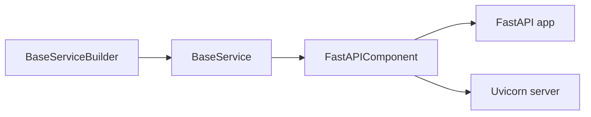

# Current Baseline

## Target Version and Status

- **Version:** `v0.2.0`
- **Status:** Complete as a historical release; baseline verification needs
  repair in `v0.3.0`

## Scope and Interfaces

The baseline exposes:

- `BaseComponent.initialize()`
- `BaseComponent.run()`
- `BaseComponent.stop()`
- `BaseServiceBuilder.with_fastapi()`
- `BaseService.run()`
- `FastAPIComponent.add_api_router()`
- `FastAPIComponent.attach_lifespan()`

The included FastAPI component creates an application, registers middleware,
starts Uvicorn, and requests shutdown.

## Known Gaps

- `initialize()` is synchronous despite the all-async component policy.
- Registration is limited to the explicit FastAPI setter rather than a generic
  extension point.
- Bootstrap is the service-level pre-run hook.
- Long-running component detection relies on comparing method implementations.
- shutdown does not expose startup or stop ordering guarantees.
- configuration uses direct environment access rather than Pydantic.

## Edge Cases to Preserve

- Existing `with_fastapi()` calls continue to work through `v0.3.0`.
- Consumers may provide a prebuilt FastAPI app.
- `BaseComponent` utility implementations may omit run and stop behavior.
- Stopping an unstarted FastAPI server remains a no-op.

## Implementation Tasks

This segment requires no new implementation. Its gaps are assigned to
[01-async-lifecycle.md](./01-async-lifecycle.md) and
[02-settings-observability.md](./02-settings-observability.md).

## Verification

- Record the existing release as historical baseline in the proposal.
- Make the repository test suite pass before advertising a new release.
- Confirm the public baseline examples against the package version they target.
