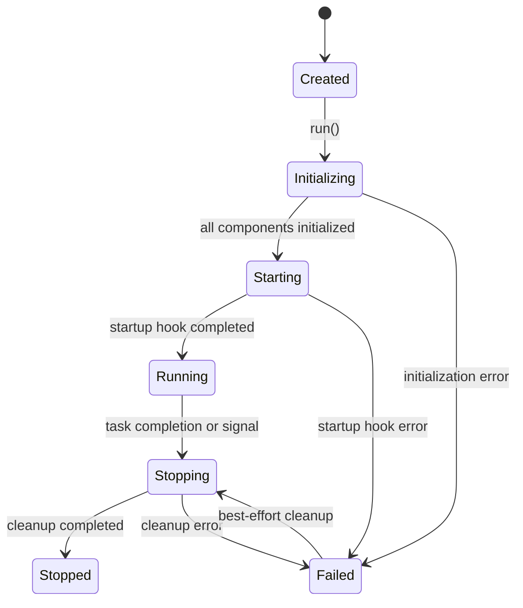

# Async Lifecycle and Composition

## Target Version and Status

- **Version:** `v0.3.0`
- **Status:** Complete

## Goal

Make `BaseService` a predictable asynchronous component container with a stable
public registration and shutdown contract.

## Scope

Included:

- asynchronous initialization and hooks
- explicit bundled-component registration
- duplicate-key protection
- explicit lifecycle state
- reliable graceful shutdown after partial or failed startup
- compatibility for the existing FastAPI builder

Deferred:

- dependency graph scheduling
- component hot reload
- distributed coordination
- process supervision beyond the owning event loop

## Public Interfaces

Proposed core shapes:

```python
class BaseComponent(ABC):
    async def initialize(self) -> None: ...
    async def run(self) -> None: ...
    async def stop(self) -> None: ...


class BaseService:
    def set_fastapi_component(self, component: FastAPIComponent) -> Self: ...
    def get_component(
        self, key: ComponentRegistry
    ) -> BaseComponent | None: ...
    async def bootstrap(self) -> None: ...
    async def shutdown(self) -> None: ...
```

`ComponentRegistry` identifies bundled components. The base service intentionally
exposes explicit setters instead of a generic registration API. A new built-in
component receives its own setter and registry entry.

Registration returns the service to support a fluent API. Registering an active
component twice raises `ValueError`.

## Lifecycle States



Initialization follows registration order. The bootstrap hook runs after every
component initializes. Every component's async `run()` method is scheduled
concurrently; utility components use the base no-op implementation. Shutdown
follows reverse registration order so dependants stop before dependencies.

## Component Discovery

Every component participates in the same asynchronous lifecycle. A component
that does not own runtime work inherits the base no-op `run()` and `stop()`
methods, avoiding markers and method-introspection rules.

## Failure and Edge-Case Policy

- initialization failures cancel already-started work and stop initialized
  components;
- if one long-running task fails, the service begins shutdown and propagates
  the original error;
- repeated stop calls are safe;
- shutdown attempts continue for remaining components after an individual
  stop failure;
- multiple shutdown errors are grouped and reported without hiding the primary
  startup or runtime failure;
- service-specific setup remains in `bootstrap()`;
- lifecycle orchestration remains at `run()`, one internal driver, and
  `shutdown()` rather than spreading across task-management methods.

## Implementation Tasks

1. Make all `BaseComponent` lifecycle methods asynchronous.
2. Add explicit bundled-component registration and route the FastAPI builder
   through it.
3. Add lifecycle state and reject duplicate or invalid registrations.
4. Keep `bootstrap()` as the service-level pre-run hook.
5. Track initialized and started components independently.
6. Start long-running tasks under structured task management.
7. Shut down in reverse order and collect cleanup errors.
8. Document the synchronous-to-async migration for component authors.
9. Update the existing tests and add failure-path coverage.

## Verification

- registration is limited to explicit bundled-component setters;
- duplicate component registration fails before replacing the first component;
- startup observes completed asynchronous initialization;
- utility components use base no-op lifecycle methods;
- component run failure triggers cleanup and is propagated;
- partial initialization stops only components that acquired resources;
- shutdown is idempotent and reverse ordered;
- `KeyboardInterrupt`, `SystemExit`, and ordinary exceptions all preserve
  cleanup behavior;
- the existing FastAPI builder example still builds and runs.

## v0.2.0 Migration

- Change component `initialize()` methods from synchronous functions to
  asynchronous functions.
- Keep service pre-run logic in `bootstrap()`.
- Add bundled components through explicit setters such as
  `set_fastapi_component()`.
- Make component `stop()` methods idempotent. They are now called for every
  component whose initialization was attempted.
