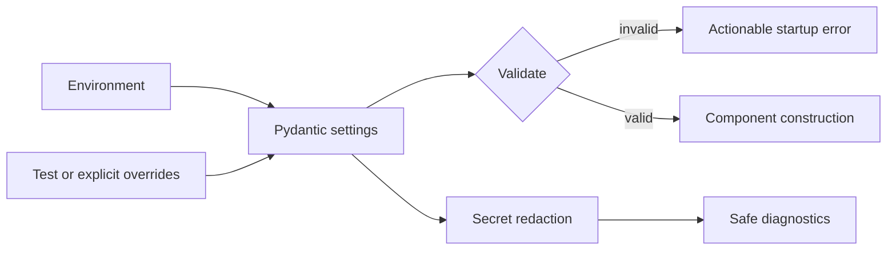

# Settings and Observability

## Target Version and Status

- **Version:** `v0.4.0`
- **Status:** Complete

## Scope

Provide Pydantic-based base settings, structured logging, correlation
context, and dependency health contracts without selecting a mandatory tracing
or metrics vendor.

## Settings Contract

```python
class ServiceSettings(BaseSettings):
    service_name: str
    environment: str = "local"
    log_level: str = "INFO"
    log_format: Literal["text", "json"] = "json"
    shutdown_timeout_seconds: float = 30
```

Derived settings extend this model with component-specific settings. Explicit
constructor values override environment values in tests. Validation occurs
before external clients are created.



## Logging Contract

Every component records:

- service and component name
- event or action name
- lifecycle state
- severity
- optional correlation identifier
- exception information for failures

Logging setup must be idempotent. Secret fields are represented as redacted
values in rendered settings and log output.

## Health Contract

```python
class HealthStatus(StrEnum):
    HEALTHY = "healthy"
    DEGRADED = "degraded"
    UNHEALTHY = "unhealthy"


class HealthCheckResult(BaseModel):
    status: HealthStatus
    component: str
    message: str | None = None
```

Components can expose an asynchronous health check. The service aggregates
results:

- liveness checks only process/event-loop continuity;
- readiness checks required components;
- optional component degradation does not fail readiness by default;
- health timeouts become unhealthy results rather than hanging a probe.

## Edge Cases

- missing required settings report the field path without its value;
- secret-like custom fields can be explicitly redacted;
- duplicate logger handlers do not multiply messages;
- invalid log levels fail at configuration time;
- one failing health check does not prevent other checks from completing;
- settings remain constructible without an external dotenv package.

## Implementation Tasks

1. Add Pydantic Settings as the configuration base dependency.
2. Define service and environment settings with explicit precedence.
3. Replace direct logger construction with idempotent configuration.
4. Add correlation-context helpers using context variables.
5. Add text and JSON formatters with consistent field names.
6. Add health result models, check protocols, and timeout handling.
7. Document safe extension of settings and redaction.
8. Replace FastAPI environment parsing in the next FastAPI segment.

## Verification

- settings load from environment and explicit values;
- invalid ports, timeouts, and log levels fail before startup;
- secret values do not appear in logs or validation displays;
- logger setup remains stable across repeated configuration;
- correlation values propagate across awaited operations;
- readiness handles healthy, degraded, unhealthy, and timed-out components;
- no settings test requires a real external service.
