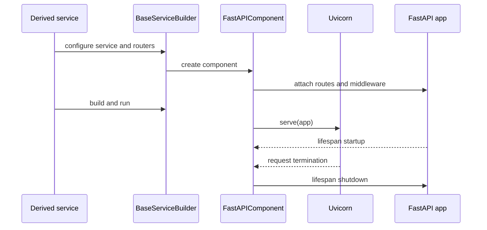

# FastAPI Service Contract

## Target Version and Status

- **Version:** `v0.5.0`
- **Status:** Planned

## Scope

Harden the existing FastAPI component around typed configuration, router
registration, lifespan ownership, dependency checks, and standard operational
endpoints.

## Public Interfaces

`FastAPIConfig` becomes a Pydantic settings model with at least:

- title, description, and version
- host and port
- debug and reload
- CORS policy
- health route prefix
- startup and shutdown grace periods

`FastAPIComponent` supports:

- using a generated or supplied `FastAPI` app
- registering one or many `APIRouter` instances
- registering lifespan hooks
- adding middleware through normal FastAPI APIs
- returning the app for dependency-injection setup
- exposing health routes after component policy is configured

## Request and Lifecycle Flow

## Health Endpoints

Default endpoints:

- `GET /health/live`
- `GET /health/ready`

Response bodies use the health result model from `v0.4.0`. A derived service can
change the prefix or disable these routes, but must do so explicitly.

## CORS and Security Defaults

- permissive CORS is not the default outside local development;
- credentials cannot be combined with wildcard origins;
- invalid CORS entries fail settings validation;
- server headers and debug behavior are controlled by environment-specific
  settings;
- route registration validates inputs and reports route collisions during app
  construction.

## Edge Cases

- a supplied app retains its existing middleware and lifespan behavior;
- multiple lifespan hooks compose in registration order;
- a router cannot be attached after server initialization unless a supported
  app-factory flow is used;
- shutdown remains a no-op before Uvicorn starts;
- a failed server bind propagates as startup failure;
- `reload` is allowed for local development and rejected in managed production
  defaults.

## Implementation Tasks

1. Replace manual `FastAPIConfig` with Pydantic settings.
2. Preserve default environment compatibility for existing consumers.
3. Add router, middleware, and lifespan builder helpers.
4. Register liveness and readiness endpoints.
5. Compose FastAPI lifespan with the service lifecycle where both are used.
6. Add bounded graceful shutdown.
7. Add an importable ASGI application example.
8. Update README examples to use the public builder API only.

## Verification

- all existing FastAPI tests pass after migration;
- settings reject invalid ports and unsafe production CORS combinations;
- generated and supplied apps support route registration;
- health routes report service and component health;
- startup and shutdown execute exactly once;
- server bind and serve failures trigger service cleanup;
- no tests open a real listening socket.
