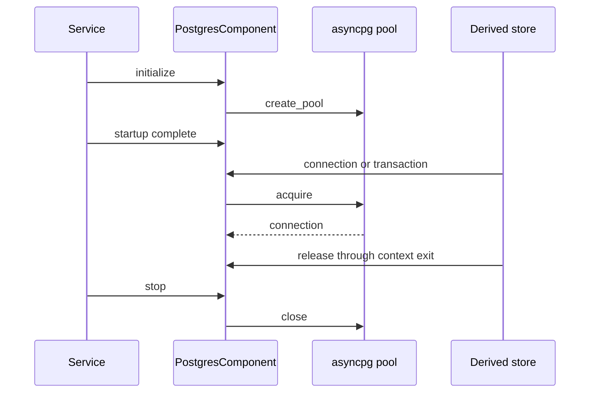

# PostgreSQL Component

## Target Version and Status

- **Version:** `v0.6.0`
- **Status:** Planned

## Scope

Provide an asynchronous PostgreSQL component using `asyncpg`. The component
owns connection-pool setup, health, shutdown, and safe connection interfaces.
It does not own schemas, migrations, queries, repositories, or domain models.

## Settings and Interfaces

```python
class PostgresSettings(BaseSettings):
    dsn: SecretStr
    min_pool_size: int = 1
    max_pool_size: int = 10
    command_timeout_seconds: float = 10
    connection_timeout_seconds: float = 10
    readiness_required: bool = True
```

```python
class PostgresComponent(BaseComponent):
    @property
    def pool(self) -> PostgresPool: ...

    @asynccontextmanager
    async def connection(self): ...

    @asynccontextmanager
    async def transaction(self): ...

    async def health(self) -> HealthCheckResult: ...
```

The public annotations use a narrow base-service protocol where practical so
stores do not need to import `asyncpg` implementation types.

## Lifecycle



## Failure and Edge-Case Policy

- pool creation is bounded by a startup timeout;
- a health query is bounded independently from normal command timeouts;
- acquire and checkout errors preserve their original exception;
- shutdown closes the pool only after consumer tasks have stopped;
- rollback occurs automatically when a transaction context raises;
- the DSN never appears in logs or string-rendered settings;
- pool access before initialization and after shutdown fails with a clear
  lifecycle error.

## Implementation Tasks

1. Add `asyncpg` and dependency metadata.
2. Define PostgreSQL settings and validation.
3. Implement pool initialization, health, and shutdown.
4. Add connection and transaction context managers.
5. Define store-facing protocols for acquisition and execution.
6. Register the component with the builder using a stable registry key.
7. Document repository construction in a derived service.
8. Add tests with mocked pools, connections, and transactions.

## Verification

- pool creation receives validated limits and timeouts;
- the DSN is redacted from settings and logs;
- connection and transaction contexts always release or roll back;
- health checks distinguish healthy, timeout, and unavailable states;
- stop closes a pool once and is safe on partial initialization;
- no base-service test connects to PostgreSQL;
- a sample store uses only the exposed repository-facing interface.
