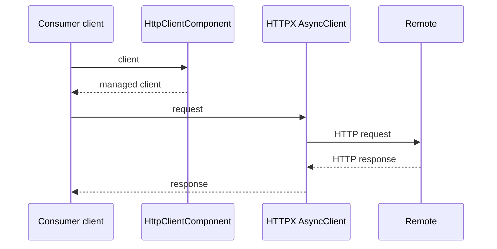

# HTTP Client Component

## Target Version and Status

- **Version:** `v0.7.0`
- **Status:** Planned

## Scope

Manage one reusable asynchronous HTTPX client so derived services do not
duplicate pool, timeout, redirect, proxy, and shutdown setup. Endpoint-specific
authentication, models, and retry policy remain in consumer clients.

## Settings and Interface

```python
class HttpClientSettings(BaseSettings):
    connect_timeout_seconds: float = 5
    read_timeout_seconds: float = 10
    write_timeout_seconds: float = 10
    pool_timeout_seconds: float = 5
    max_connections: int = 100
    max_keepalive_connections: int = 20
    follow_redirects: bool = False
```

```python
class HttpClientComponent(BaseComponent):
    @property
    def client(self) -> httpx.AsyncClient: ...
```

Derived clients can receive the managed `AsyncClient` and build typed methods
for their external systems.

## Request Flow



## Policy Boundaries

Base-service owns:

- client creation and close
- connection limits
- timeout defaults
- proxy and transport configuration
- optional safe request event hooks

Derived services own:

- endpoint URLs
- authentication
- authorization headers
- request and response models
- business retries and idempotency rules

## Edge Cases

- access before initialization fails clearly;
- close is safe if client construction never completed;
- timeout values must be positive;
- redirect policy is explicit;
- proxy credentials are redacted from diagnostics;
- event hooks must not delay requests without a documented timeout;
- the managed client is not independently closed by derived clients.

## Implementation Tasks

1. Add or confirm the HTTPX runtime dependency.
2. Define settings and validated transport limits.
3. Implement client initialization and asynchronous close.
4. Expose the managed-client protocol.
5. Add correlation-header hooks without overwriting consumer-owned headers.
6. Add builder registration and health metadata.
7. Document an example typed API client.
8. Add mocked transport tests.

## Verification

- the client is created once per component lifecycle;
- timeout and pool values reach HTTPX;
- close is called once during shutdown;
- mock transport exercises request and response paths;
- consumer endpoint policies remain outside the component;
- no test makes a network request.
