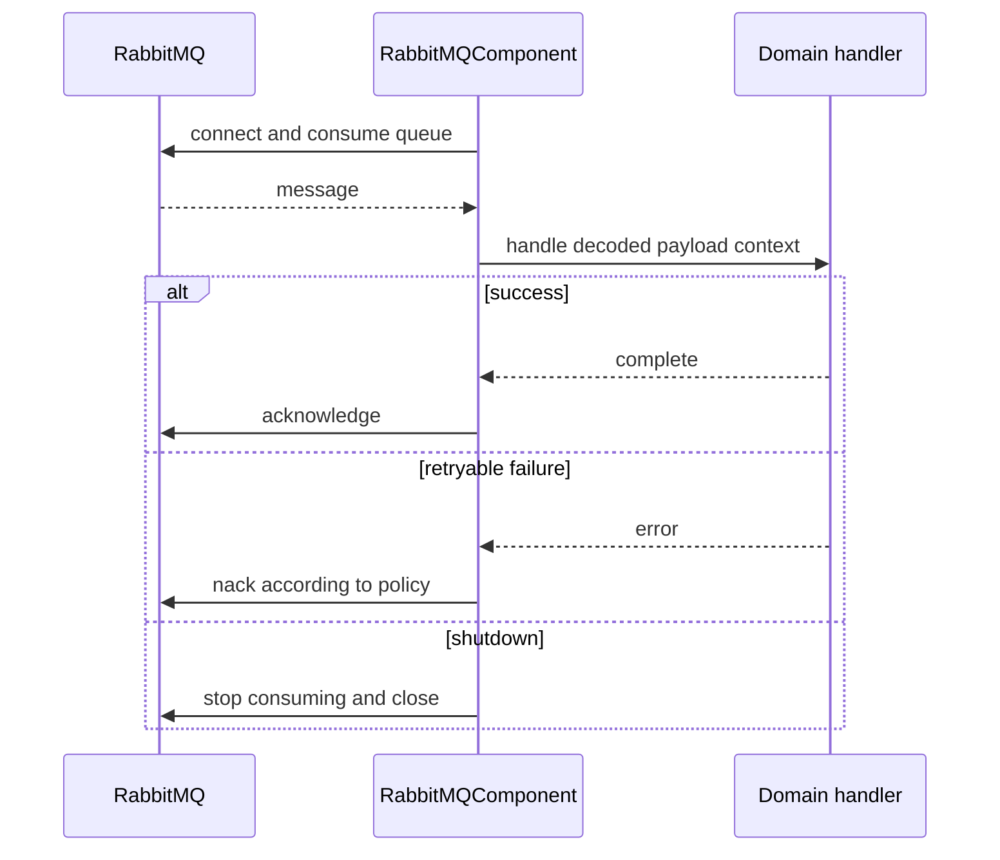

# RabbitMQ Component

## Target Version and Status

- **Version:** `v0.8.0`
- **Status:** Planned

## Scope

Provide an asynchronous RabbitMQ connection, channel, publish, and consumer
runtime. Domain exchange names, routing keys, message models, handler behavior,
and schema evolution remain in derived services.

## Technology Choice

Use `aio-pika` as the initial implementation candidate because it exposes
async connection, channel, exchange, queue, publish, and acknowledgement APIs.
The client can be revisited if evaluation finds weak reconnect behavior or
maintenance risk before implementation starts.

## Settings and Interfaces

```python
class RabbitMQSettings(BaseSettings):
    dsn: SecretStr
    connection_timeout_seconds: float = 10
    heartbeat_seconds: int = 60
    prefetch_count: int = 10
    reconnect_delay_seconds: float = 5
    readiness_required: bool = True
```

```python
class RabbitMQComponent(BaseComponent):
    async def publish(
        self,
        message: OutboundMessage,
        routing: MessageRouting,
    ) -> None: ...

    async def subscribe(
        self,
        routing: MessageRouting,
        handler: AsyncMessageHandler,
    ) -> ConsumerHandle: ...
```

`OutboundMessage` contains opaque bytes, content type, message identity,
headers, and delivery metadata. Base-service does not select a domain
serialization format.

## Consumer Flow



## Delivery Policy

- publishing provides persistent messages by default;
- handler acknowledgements are explicit;
- retries and dead-lettering are configured per subscription;
- publisher confirms are exposed as delivery completion where supported;
- reconnects do not silently create duplicate consumers;
- shutdown stops accepting messages, waits for bounded in-flight handlers, and
  then closes channels.

## Edge Cases

- connection loss distinguishes transient reconnect from startup failure;
- all queued callbacks are cancelled or drained during stop;
- duplicate subscription handles are rejected;
- invalid prefetch, heartbeat, and timeout values fail settings validation;
- credentials and complete DSNs remain redacted;
- a handler's exception never terminates the connection loop by accident.

## Implementation Tasks

1. Add `aio-pika` and validate its supported Python version.
2. Define connection, channel, message, and subscription protocols.
3. Implement connection and channel initialization.
4. Implement publisher-confirmed publish support.
5. Implement subscription ownership and bounded handler concurrency.
6. Define acknowledgement and retry policies as extension points.
7. Add reconnect and shutdown behavior.
8. Add a derived-service handler example with no domain coupling.
9. Add mocked broker and consumer tests.

## Verification

- publish receives immutable routing and message metadata;
- handler success acknowledges once;
- handler failure follows configured retry or reject behavior;
- reconnect creates no duplicate active subscription;
- stop waits only up to the configured limit for in-flight work;
- readiness changes on connection loss and recovery;
- DSNs and credentials are never logged;
- no base-service test starts RabbitMQ.
