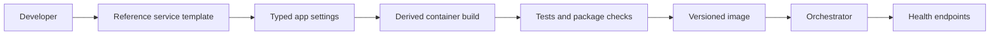

# Operational Hardening

## Target Version and Status

- **Version:** `v0.9.0`
- **Status:** Planned

## Scope

Turn the component collection into an adoptable foundation through a
representative derived service, container usage, automated checks, migration
guidance, and operational documentation.

## Reference Service

The repository should include a small example derived service demonstrating:

- one application router
- one PostgreSQL repository interface
- one typed HTTP client
- one RabbitMQ handler
- Pydantic settings
- health routes
- graceful shutdown

The example may run in mock or local-development mode for tests. It must not
become a production application or a kitchen sink of unrelated features.

## Delivery Flow

## Container Contract

- the base image runs as an unprivileged user;
- the package is installed at a versioned release, not copied from an
  uncontrolled source for published images;
- derived images add application code and a documented command;
- build context excludes tests, caches, secrets, and local environment files;
- image metadata records source and version;
- development and production dependency sets remain distinct.

## Continuous Integration

Required checks:

1. unit tests with mocked integrations;
2. coverage for new and changed behavior;
3. formatting and linting;
4. static type checking;
5. package build and installation smoke test;
6. container build and startup smoke test;
7. dependency and vulnerability reporting;
8. changelog and version consistency.

## Documentation

- minimal quick start for a derived service;
- component catalog with when-to-use and extension points;
- settings reference generated or checked against Pydantic models;
- lifecycle diagrams;
- troubleshooting for startup, readiness, and shutdown failures;
- migration notes from each breaking prerelease;
- supported Python policy.

## Edge Cases

- CI must not require real PostgreSQL or RabbitMQ;
- container smoke tests must not rely on host credentials;
- generated docs cannot hide source settings definitions;
- the reference service should fail fast with missing required settings;
- a derived image may replace the command without replacing base lifecycle
  contracts.

## Implementation Tasks

1. Create the reference derived service outside the public base package.
2. Add a container inheritance example and startup smoke command.
3. Add formatting, lint, type, package, and image checks.
4. Add dependency scanning without recording secrets in CI.
5. Add public API and settings documentation generation checks.
6. Add release automation and changelog validation.
7. Add upgrade notes for the `v0.2.0` lifecycle migration.
8. Run the quality gates on the supported Python matrix.

## Verification

- the reference service builds only from documented public APIs;
- the container starts and serves liveness with mockable dependencies;
- CI passes without external infrastructure;
- package installation works from the built wheel;
- no secrets or local artifacts enter source or image distributions;
- release checks fail on inconsistent versions;
- a new consumer can follow quick-start documentation without private
  implementation imports.
