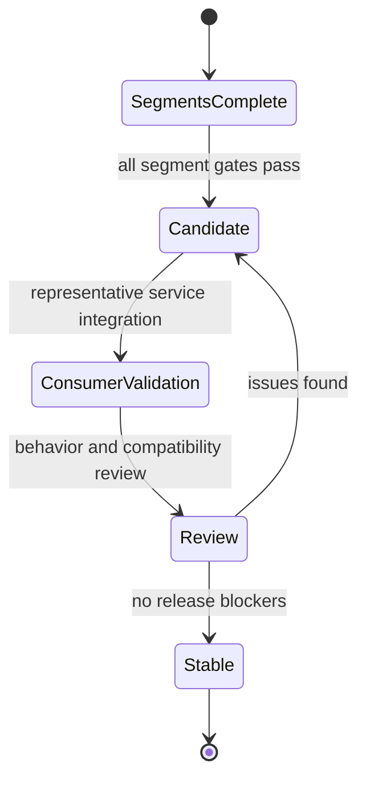

# Production Baseline

## Target Version and Status

- **Version:** `v1.0.0`
- **Status:** Planned

## Goal

Declare stable base-service contracts only after a representative derived
service has exercised the full lifecycle with mocked base tests and its own
real-infrastructure integration suite.

## Scope

Included:

- compatibility policy for public APIs
- complete reference-service validation
- production readiness review
- version and documentation normalization
- release candidate testing
- stability for lifecycle, FastAPI, settings, health, PostgreSQL, HTTPX, and
  RabbitMQ interfaces

Deferred:

- new infrastructure integrations
- multi-language support
- domain frameworks
- hosted deployment control planes

## Release Readiness Flow

## Compatibility Contract

For the `v1.x` line:

- patch releases contain compatible fixes;
- minor releases add compatible capabilities or optional integrations;
- major releases are required to remove or change public contracts;
- configuration additions preserve existing defaults where practical;
- deprecations have migration guidance and a published removal milestone;
- driver-specific details are not public contracts unless explicitly documented.

## Production Readiness Checklist

### Lifecycle

- repeated startup and stop attempts are defined
- partial startup cleans up deterministically
- shutdown has a bounded timeout
- task and exception behavior is observable

### Integrations

- pool and connection settings have safe defaults
- reconnect behavior does not multiply work
- health distinguishes process and dependency readiness
- mocks cover failure behavior in base-service
- the representative consumer exercises real infrastructure separately

### Security and privacy

- credentials are secret typed and redacted
- the base image runs unprivileged
- dependency and image checks are part of release
- debug mode is not silently enabled in production

### Developer experience

- a service can be scaffolded without private imports
- configuration errors identify the field, not the secret
- common tests and protocols can be reused by consumers
- README and proposal examples are executable

## Implementation Tasks

1. Freeze and audit public exports.
2. Test the package from a clean install and container.
3. Validate a derived service against the complete local component set.
4. Complete that service's real-infrastructure tests in its own repository.
5. Review configuration and error messages for secret exposure.
6. Resolve remaining high-severity lifecycle and reconnect cases.
7. Publish a release candidate.
8. Record the compatibility policy and `v1.0.0` changelog.
9. Tag and publish only after all release gates pass.

## Verification

- clean installation has no undeclared dependency;
- the reference service uses only documented interfaces;
- all lifecycle and component tests pass;
- release candidate smoke tests pass for package and container;
- no open blocker affects data loss, leaked resources, secrets, or shutdown;
- the derived service's separate integration suite validates PostgreSQL and
  RabbitMQ behavior;
- `v1.0.0` documentation matches the installed public API.
