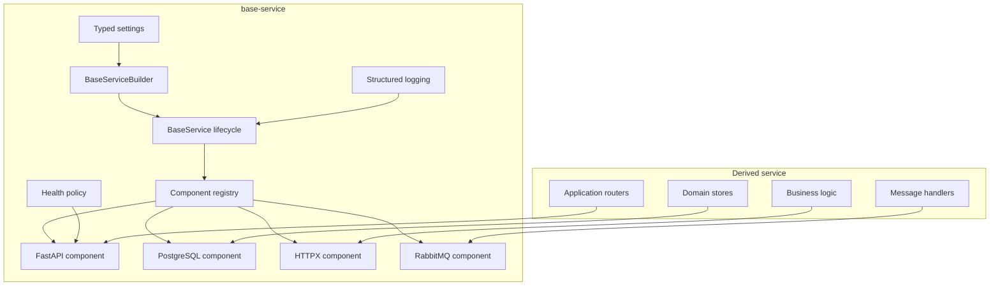

# Base Service Implementation Proposal

## Purpose

This proposal turns [PLAN.md](../PLAN.md) into independently deliverable
feature segments. Each segment has a semantic version, a clear public contract,
and verification criteria.

Roadmap versions are package releases. The existing `0.1.0` and `0.2.0`
entries in [CHANGELOG.md](../../CHANGELOG.md) are retained rather than rewritten.

## Current Baseline

The repository already provides:

- a `BaseService` and builder
- a component base class
- a `FastAPIComponent` that creates an app and runs Uvicorn
- a Python 3.13 base container
- initial unit tests and package metadata

After `v0.3.0`, the remaining roadmap gaps are:

- external integrations and Pydantic settings are absent
- health, readiness, structured logging, and release checks are incomplete

The async lifecycle and composition segment closes the baseline container gaps
before new external integrations are added.

## Release Roadmap

| Version | Segment | Status | Outcome |
| --- | --- | --- | --- |
| `v0.1.0` | Initial component container | Complete | Historical base package |
| `v0.2.0` | FastAPI component | Complete | Historical FastAPI baseline |
| `v0.3.0` | [Async lifecycle and composition](./01-async-lifecycle.md) | Complete | Reliable, generic service lifecycle |
| `v0.4.0` | [Settings and observability](./02-settings-observability.md) | Planned | Typed configuration, logging, health contracts |
| `v0.5.0` | [FastAPI service contract](./03-fastapi-contract.md) | Planned | Extensible web component and health routes |
| `v0.6.0` | [PostgreSQL component](./04-postgresql.md) | Planned | Managed async pool and repository-facing interface |
| `v0.7.0` | [HTTP client component](./05-http-client.md) | Planned | Managed HTTPX client |
| `v0.8.0` | [RabbitMQ component](./06-rabbitmq.md) | Planned | Managed publish and consume lifecycle |
| `v0.9.0` | [Operational hardening](./07-operational-hardening.md) | Planned | Reference service, CI, image, and migration guidance |
| `v1.0.0` | [Production baseline](./08-production-baseline.md) | Planned | Stable public contracts and validated derived service |

## Architecture by v1.0.0

## Dependency Rules

- A later component may depend on lifecycle and settings contracts from
  earlier segments.
- Domain models, repositories, routes, and message schemas remain in derived
  services.
- Components expose protocol-oriented interfaces instead of requiring consumers
  to depend on driver internals.
- Optional infrastructure dependencies remain absent until the corresponding
  component is implemented.
- No segment may claim readiness using real database or broker integration
  tests in this repository. Those tests use mocks here and run with real
  infrastructure in consuming services.

## Cross-Segment Quality Gates

Every feature segment must:

1. update the public API and implementation together;
2. include focused unit tests for success, failure, and cleanup paths;
3. use only asynchronous lifecycle methods for components;
4. avoid logging secret values;
5. document the derived-service integration point;
6. preserve compatibility unless a breaking change is scheduled;
7. update the changelog when released; and
8. pass the repository's configured tests and checks.

## Completion Policy

A segment becomes `Complete` only after:

- its public interfaces are implemented;
- its verification criteria are automated;
- related documentation is executable against the public API;
- compatibility or migration notes are present where needed; and
- the assigned semantic release is recorded in the changelog.

Implementation should proceed in roadmap order. Later segments may be prototyped
in isolation, but must not be released before their dependencies are complete.
